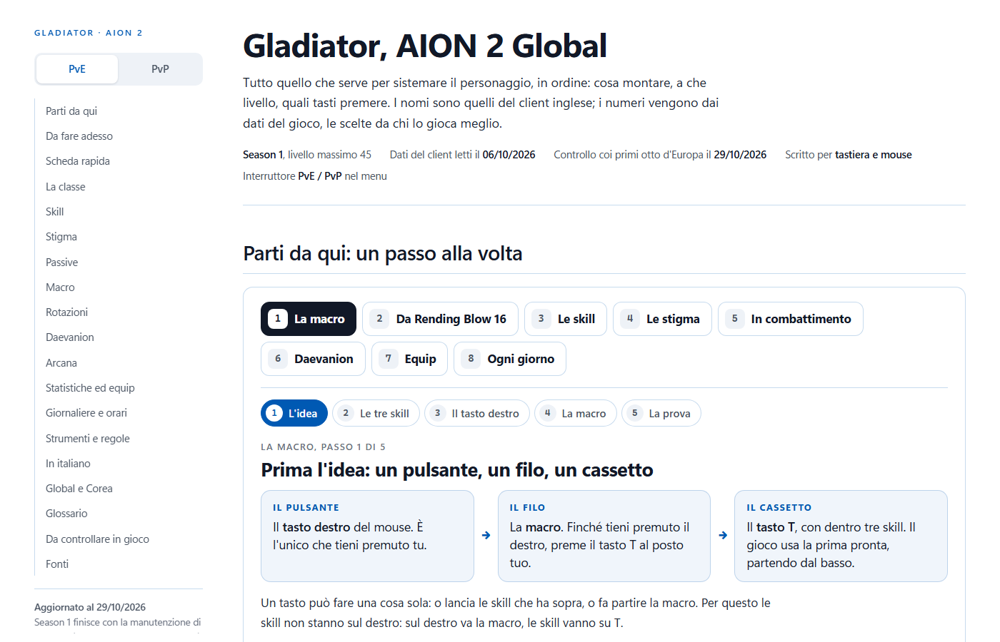

# aion2-build-guide

[](https://github.com/Michel9329/aion2-build-guide/actions/workflows/test.yml)

Build guides for AION 2 (Global, Season 1), generated from curated data files. The generator stops when the data contradict each other, and a mutation test shows that the numeric check actually catches errors.

Built with Claude Code, designed and reviewed by Michel Dimitri.

> Fan project. Not affiliated with, endorsed by or connected to NCSoft. Class, skill, stigma and item names, and any other game terms, belong to their respective owners.

## What it is

Four class guides (Gladiator, Ranger, Chanter, Cleric with a second heal build) written as data, not as a page. One script turns a class's data into a single self-contained HTML file. The guide text is in Italian.


*The Gladiator guide as generated, without game screenshots or icons.*

Three pieces make the data trustworthy:

1. **The generator stops on contradictions.** `hub/build.mjs` fails with a list of problems when a text points at a skill that does not exist, quotes a source that is not in the source list, picks a specialization that is not among the options, or repeats an id. It never writes a page with a dangling reference.
2. **A numeric check.** `tools/verify_entities.py` compares every skill name, level, cooldown, MP cost, range, specialization and passive value in `entities.json` with a reference dump of the game's skill pages taken from a public skill database, plus the figures quoted in the summary texts. It exits with code 1 on any difference.
3. **A mutation test.** `tools/mutate_entities.py` injects 17 realistic errors into a copy of the data (a wrong cooldown, a swapped Korean name, a specialization at the wrong level, a pick that is not unlocked yet, a changed passive value, a changed figure in a summary) and counts how many the check finds. It exits 0 only if all 17 are found and the untouched data passes. A check that has never been shown to fail is not worth much; this is that proof.

## Quick start

Needs Node 20 or newer, and Python 3.9 or newer for the checks. No dependencies to install.

```
# build the Gladiator guide into out/gladiator/index.html
AION_NO_SHOTS=1 node hub/build.mjs data/classes/gladiator/guide.json out/gladiator

# the other classes
AION_NO_SHOTS=1 node hub/build.mjs data/classes/ranger/guide.json out/ranger
AION_NO_SHOTS=1 node hub/build.mjs data/classes/chanter/guide.json out/chanter
AION_NO_SHOTS=1 node hub/build.mjs data/classes/cleric/guide.json out/cleric
AION_NO_SHOTS=1 node hub/build.mjs data/classes/cleric/builds/cura/guide.json out/cleric-cura

# tests: the build is clean on real data and stops on broken references
node --test test/build.test.mjs
```

On Windows PowerShell set the variable first: `$env:AION_NO_SHOTS = "1"`.

Output is two files: `index.html` (a full page, opens with a double click) and `artifact.html` (content only, for embedding). The page is not edited by hand: change the data and rebuild.

### About `AION_NO_SHOTS`

Some guide sections show annotated in-game screenshots from `data/shots/`. Those images are NCSoft assets and are not included. Without them the generator refuses to build, because a missing figure is a missing file. With `AION_NO_SHOTS=1` it skips the figures, says how many it skipped, and still runs every other check. Put your own captures in `data/shots/<name>.webp` (the names are in the `img` fields of the `fig` blocks) and drop the variable to get the full page.

## Checking the numbers

### Without the client dumps (what this repository can run)

The reference dumps used by the author come from third-party sites and are not redistributed here. To show that the checker and the mutation test work, `tools/make_demo_fixture.py` builds a reference set from the entities file itself:

```
python -I tools/make_demo_fixture.py data/classes/gladiator/entities.json .demo/gladiator 11
python -I tools/verify_entities.py     data/classes/gladiator/entities.json .demo/gladiator
python -I tools/mutate_entities.py     data/classes/gladiator/entities.json .demo/gladiator .demo/tmp
```

Expected: `controlli eseguiti: 456 | differenze: 0`, then 17 lines `TROVATO ...` and `errori iniettati: 17 | trovati: 17 | originale pulito: True`.

The last argument of `make_demo_fixture.py` is the class id prefix that selects the table of quoted figures inside `verify_entities.py`: `11` Gladiator, `14` Ranger, `18` Chanter, `17` Cleric. The mutation script's mutations are written for the Gladiator data.

Be clear about what this shows. The reference is derived from the curated file, so the run proves that the check catches deviations and that the mutation test detects them. It does not prove that the curated numbers are right.

### Against real client data

`verify_entities.py <entities.json> <raw-dir>` expects a folder with two files:

- `canon-en.json`: a list of skills, each with `id` (numeric string whose first two digits are the class prefix), `name`, `ko`, `cat` (`active`, `stigma`, `passive`), `specs` (`[{at, text}]`), `range_m` and `desc`.
- `scaling.json`: a list keyed by `name` with `cooldown_s`, `mp`, `scaling` (`[{key, values: {"1", "10", "20"}}]`) and `damage`.

Build them from the game's English skill pages (the author used a public skill-builder database, read once per patch). Then run the same two commands with that folder instead of `.demo/...`.

## Data layout

```
data/classes/<class>/
  guide.json      the page: meta, sources, sections made of typed blocks, glossary, macros, rotations
  entities.json   skills, chains, stigma, passive: one record per skill, with the numbers
data/classes/cleric/builds/cura/   a second build of the same class (own guide.json and entities.json)
hub/build.mjs     the generator
hub/hub.css       page styles
hub/hub.js        PvE/PvP switch and navigation
lib/passive-tiers.mjs   which passives are worth hunting for on gear, from two numbers per passive
tools/            verify_entities.py, mutate_entities.py, make_demo_fixture.py
test/             node:test checks for the generator
```

`entities.json` records carry `id`, `name`, Korean `ko` name, a one-line `sum`, a `meta` line (`Ricarica 5 s · 0 MP · 4 m`), the game's specialization options or unlocks with the Italian meaning, PvE and PvP picks per skill level, and for passives a `scale` table with the values at levels 1, 10 and 20.

`guide.json` text uses light markup: `**bold**`, `[[skill-id]]` (becomes the skill's name and fails if the id does not exist), `{{KEY}}` for a keycap, `[text](https://...)`, and `[^source-id]` for a numbered citation that must exist in `sources`. Block types: `p`, `h3`, `list`, `note`, `callout`, `table`, `steps`, `seq`, `flow`, `fig`, `passives`.

## Limits

- The guide describes one season of one game and goes stale at the next patch. Dates in the text show when each figure was read.
- The text is Italian. The skill and item names are the English names used by the Global client.
- The numeric check covers the 35 skill cards of a class and the figures listed in `FACTS` inside `verify_entities.py`. Prose elsewhere (strategy, rotations, gear advice) is checked only for broken references, not for truth.
- Gear targets, Arcana card data and the Daevanion plans that feed the author's desktop app are not part of this repository. The `gear` and `top` fields on passives, which drive the passive table, are.
- The demo fixture is self-referential, as explained above.
- Screenshots and skill icons are not included. Without icons the skill rows show initials.
- The guide text and the generator's console messages are in Italian; this README is the English entry point.

## License

Code and the data written by the author: MIT, Copyright (c) 2026 Michel Dimitri (see `LICENSE`). The MIT license covers the author's own work. It does not give any rights over the names, text and artwork of AION 2, which belong to NCSoft and other owners. Figures were read from the game and from public community sources, which the guides list under their sources section.

---

## Nota in italiano

Guide alle build di AION 2 (Global, Stagione 1) generate da file di dati. Il generatore (`hub/build.mjs`) si ferma se i dati si contraddicono: una skill citata che non esiste, una fonte non in elenco, una specializzazione che non è tra le opzioni. Un controllo numerico (`tools/verify_entities.py`) confronta nomi, livelli, ricariche, costi in MP e valori delle passive con i dati del client, e un test di mutazione (`tools/mutate_entities.py`) inietta 17 errori e verifica che il controllo li trovi tutti.

Come si rigenera: `AION_NO_SHOTS=1 node hub/build.mjs data/classes/gladiator/guide.json out`. Le schermate del gioco e i dati grezzi scaricati da siti terzi non sono nel repository: il README spiega come procurarseli e come provare comunque il controllo con una prova costruita dai dati stessi, che dimostra che il controllo funziona ma non che i numeri sono giusti.

Progetto di fan, non affiliato con NCSoft. Costruito con Claude Code, progettato e rivisto da Michel Dimitri.

---

A side project. The rest of my work is at [github.com/Michel9329](https://github.com/Michel9329).
